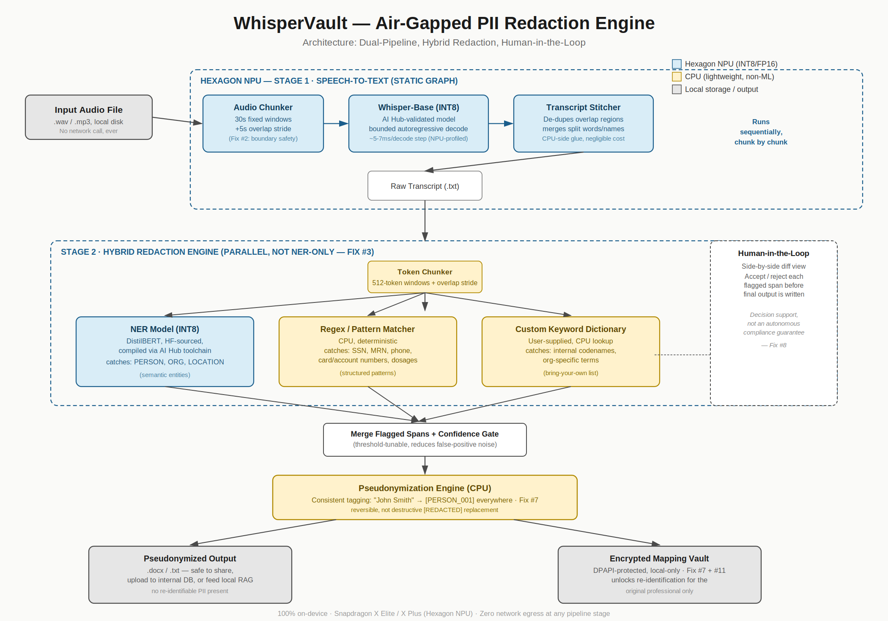

# WhisperVault

**Air-gapped speech-to-text with built-in PII pseudonymization, designed for Snapdragon X PCs (HP OmniBook X).**

Built by **Adhibhu Dhar**, Kalinga Institute of Industrial Technology (KIIT), for the
Snapdragon AI Lab Build & Present Challenge.

Legal, medical and enterprise professionals cannot send recordings to cloud transcription. Local
transcription fixes that but leaves a transcript full of raw PII that is unsafe to file, share or
feed into a local RAG system. WhisperVault transcribes on-device and immediately replaces every
sensitive span with a consistent tag (`John Smith` becomes `[PERSON_001]`), keeps the originals in an
encrypted local vault, and puts a human in the loop before anything is written.

> **Decision support, not a compliance guarantee.** No automated redaction is perfect. Review is
> part of the workflow, and this is not a certified HIPAA or legal-privilege product.



## What you can run today

```text
python -m whispervault run --transcript examples/sample_transcript.txt \
       --dict examples/codenames.txt --ner spacy --yes --out out
```

Real output from this repo (spaCy is a CPU stand-in for the NPU NER model):

```text
Interview recorded by Dr. [PERSON_001] at [ORG_001] in [LOCATION_001]. The patient, [PERSON_002], is a
forty two year old engineer working on [CODENAME_001] for [CODENAME_002].
For the record, his social security number is [SSN_001] and his medical record number is [MRN_001].
He can be reached on [PHONE_001] or at [EMAIL_001].
He also read out a second number over the phone, [SSN_002], and then asked us to call back on [PHONE_002].
His card ending in [CARD_001] was declined twice. We prescribed [DOSAGE_001] and will review in two weeks.
Later [PERSON_003] mentioned that his sister Priya lives in [LOCATION_002].
```

Look at the last line. The stand-in NER **missed "Priya"**. That is a real false negative, and it is
exactly why the review step exists. `[SSN_002]` and `[PHONE_002]` were spoken digit strings
("one two three four ...") caught by the spoken-number detector, which a written-form regex never sees.
`python -m whispervault reveal --vault out/sample_transcript.vault --input out/sample_transcript.redacted.txt`
restores the original byte for byte.

## Pipeline

1. **Audio** is cut into 30 s windows (Whisper's fixed input) with a **5 s overlap** so no word sits only on a cut.
2. **ASR**: Qualcomm AI Hub's Whisper Base. The decoder loop is bounded (`MEAN_DECODE_LEN = 200` in
   AI Hub's code), which is why it compiles to a static NPU graph.
3. **Stitch** the overlapping transcripts back together.
4. **Hybrid detection**, three detectors in parallel, because NER alone does not find structured IDs:
   * NER (people, organisations, places) in static 512-token windows with overlap
   * regex + spoken-number rules (SSN, phone, card with Luhn, email, MRN, dosage, Aadhaar, PAN, IP)
   * your own keyword dictionary, matched **literally** (never as regex)
5. **Review** (interactive): grouped by entity, ambiguous names reviewed one by one, no global accept-all.
6. **Pseudonymize** consistently and write a **metadata-free** `.txt` / `.docx`.
7. **Vault**: originals encrypted with Windows DPAPI (passphrase mode elsewhere, plus a portable backup).
8. Offer to **securely delete the source audio**.

The raw transcript is never written to disk unless you pass `--keep-raw`.

## Quick start (any OS, no models needed)

```bash
pip install -r requirements-dev.txt
python -m spacy download en_core_web_sm        # optional stand-in NER
python -m pytest -q                            # 38 tests
export WHISPERVAULT_PASSPHRASE=change-me       # Linux/macOS; Windows uses DPAPI
python -m whispervault run --transcript examples/sample_transcript.txt --dict examples/codenames.txt --ner spacy --yes --out out
```

Drop `--yes` to use the interactive review. On a Snapdragon PC, follow
[docs/SETUP_SNAPDRAGON.md](docs/SETUP_SNAPDRAGON.md) for the NPU path.

## Honest status

| | |
|---|---|
| Detectors, stitching, pseudonymization, vault, export, review | Implemented and unit-tested (38 tests) |
| AI Hub Whisper ASR wrapper, ONNX NER loader, DPAPI vault | Written against the real APIs, **not executed yet** (needs model downloads and a Windows/Snapdragon device) |
| NPU latency, power, op coverage | **Not measured yet**. The validation checklist is in the setup doc |

Full table, roadmap and known limitations: [docs/IMPLEMENTATION_STATUS.md](docs/IMPLEMENTATION_STATUS.md).

## Design decisions worth knowing

* **File in, file out.** No live microphone capture, which avoids analysing other people's speech in real time.
* **`--require-npu`** turns a silent CPU fallback into an error, so an "NPU demo" cannot quietly stop being one.
* **The dictionary is literal.** `.*` is rejected and `\w+` only matches the text `\w+`.
* **Model preparation is the only online step** (AI Hub compiles the model). Your data never touches it.

## Layout

```text
whispervault/   audio, stitch, detect/(patterns, dictionary, ner), pseudonymize, vault,
                export, review, pipeline, asr, ort_qnn, cli
tests/          38 tests    examples/  sample transcript + keywords    docs/  setup, status, diagram
```

## License
MIT. Whisper Base is provided through Qualcomm AI Hub Models (BSD-3-Clause tooling); check the licence of any NER checkpoint you use.
